# agentlanes

<p align="center"></p>

<sub>A recorded run of <code>./demo.sh</code> (real timing), then a replay of a <a href="https://github.com/metastazorg/agentlanes/blob/main/examples/landlock/real-session.txt">real Claude Code session</a> under <code>agentlanes run</code>. Regenerate with <code>tools/make_demo_svg.py</code>; video: <a href="https://github.com/metastazorg/agentlanes/blob/main/docs/demo.mp4">docs/demo.mp4</a>.</sub>

[](https://github.com/metastazorg/agentlanes/actions/workflows/test.yml)

Coordination for several AI coding agents (Claude Code, Codex, Cursor, Aider, ...) working on one Linux or macOS machine.

## The problem

- Two agents edit the same file at the same time and one silently overwrites the other.
- Two agents start a full build or test suite at once and the machine runs out of memory.
- Nobody, human or agent, can see who is working on what, or tell when another agent has finished.

agentlanes gives agents four small primitives for this: **claims** (leases on topics and paths), **slots** (an N-slot queue
for heavy commands), an **event log** that agents can block on, and a **job queue**. It is one Python package,
standard library only, no daemon. State is a directory of JSON files guarded by `flock`.

## 60-second quickstart

```sh
pip install agentlanes-cli            # Python >= 3.9, no dependencies; the command is `agentlanes`
cd your-project
agentlanes init --claude-code --agents-md
agentlanes doctor                     # every line should say ok/info; anything else comes with a fix
```

`init` is safe to run again. It creates `.agentlanes/` (this project's state, git-ignored by a `.gitignore` inside it),
merges a `PreToolUse` hook into `.claude/settings.json` without touching your other settings or hooks (the previous file
is kept as `settings.json.agentlanes-backup-<time>`), and appends the agent instructions to `AGENTS.md` once, between
`<!-- agentlanes:begin/end -->` markers. Other targets: `--claude-md`, `--cursor` (`.cursor/rules/agentlanes.mdc`),
`--strict` (see [Fail-open or fail-closed](#fail-open-or-fail-closed)).

From then on your agents (and you) work like this:

```sh
agentlanes claim login-page --paths src/login.py --pid self --desc "add OAuth button"
agentlanes who src/login.py           # -> HELD by claude-4242 (login-page, since 14:02:11) ...
agentlanes slot heavy 1 -- make -j8   # waits its turn if another agent is already building
agentlanes release login-page
agentlanes status                     # agents, claims, slots, jobs, recent events on one screen
```

In Claude Code the hook refuses an edit to a path another agent has claimed, even if the agent forgot to check
([a real session](https://github.com/metastazorg/agentlanes/blob/main/examples/claude-code/real-session.txt)). Two real Claude Code agents sharing one file: agent B saw `PATH HELD`, waited for agent A to release, then made its edit; both edits survived ([transcript](https://github.com/metastazorg/agentlanes/blob/main/examples/two-agents/real-session.txt)). Run `./demo.sh` to see three agents compete for one file and
one build slot (transcript: [demo-output.txt](demo-output.txt)); on Linux with Landlock it ends with a kernel-lane step.

On Linux, start an agent under `agentlanes run` and the kernel itself refuses writes outside its claimed paths, including
writes made through shell commands that no hook sees ([a real Claude Code session](https://github.com/metastazorg/agentlanes/blob/main/examples/landlock/real-session.txt)):

```sh
agentlanes claim login-page --paths src/auth/ --desc "add OAuth button"
agentlanes run --allow-tmp --allow-common -- claude      # writes only in src/auth/, its temp dir, its own config
```

## Commands

### Claims

| Command | What it does |
|---|---|
| `claim TOPIC [--paths a,b] [--pid self\|PID] [--desc T] [--ttl MIN] [--share]` | Take a named claim. Fails (exit 1) if another agent holds `TOPIC` or any overlapping path. A directory claim covers everything under it. `--share` allows overlap on purpose. |
| `release TOPIC` | Drop your claim. `--force` drops someone else's. |
| `renew TOPIC [--ttl MIN]` | Extend your claim. |
| `who PATH...` | Which claim covers these paths (exit 1 if any). |
| `check TOPIC` / `list [--json]` / `reap` | Is a topic held; list live claims; drop dead and expired ones now. |

Every claim expires after `--ttl` minutes (default 120). With `--pid`, the claim is a **lease**: it ends as soon as that
process exits, including on `kill -9` or an OOM kill. `--pid self` means the coding-agent process this command runs
under (found by walking up the process tree to a known agent executable: `claude`, `codex`, `cursor-agent`, `aider`,
`gemini`, ...; add names with `AGENTLANES_AGENT_NAMES=a,b`). A recycled pid is detected by process start time.

Who you are (`--by`) defaults to `$AGENTLANES_AGENT`, else `<agent>-<pid>` of the enclosing agent, else `$USER`.

### Slots

`agentlanes slot NAME N [--wait SEC] [--mem-free MB] [--max-mem MB] -- COMMAND...`

Runs `COMMAND` once one of `N` slots named `NAME` is free. Waiters are served in arrival order (FIFO); a waiter that dies
leaves the queue. The slot is a `flock` that `COMMAND` inherits, so it stays taken while `COMMAND` runs and the kernel frees
it when `COMMAND` dies, even if everything was SIGKILLed. A leftover holder record is shown as stale and cleaned.

- `--wait SEC`: give up after SEC seconds (default 1800) with exit code 75.
- `--mem-free MB`: after getting the slot, wait until this much memory is available.
- `--max-mem MB`: kill `COMMAND` above this size. Uses a systemd user scope (`MemoryMax`) when one is available,
  otherwise a watchdog that sums the RSS of the process tree every second and kills the group.
- `COMMAND` gets `AGENTLANES_SLOT=<slot number>` in its environment. Exit code is `COMMAND`'s.

`agentlanes slots [NAME] [--json]` shows holders, stale holders and waiters.

### Events

| Command | What it does |
|---|---|
| `events emit KIND [--topic T] [--msg TEXT] [key=value...]` | Append an event. Use dotted lower-case kinds, e.g. `build.done`. |
| `events tail [-n N] [--kind PREFIX] [--since 2h] [-f] [--json]` | Show recent events; `-f` follows. |
| `events wait --kind PREFIX [--topic T] [--by W] [--timeout SEC]` | Block until a *new* matching event; exit 124 on timeout. Use this instead of sleep loops. |
| `events stats [--since 24h]` | Counts per kind and per agent. |

agentlanes itself writes `claim.add/renew/done/conflict/expire/reap/blocked`, `slot.acquire/release/timeout/stale/oom/mem_wait`
and `job.add/take/done/drop/requeue`. The log is append-only JSON lines and rotates at 4 MB (`AGENTLANES_EVENTS_MAX_BYTES`).

### Jobs

`jobs add TITLE [--prio N]`, `jobs list [--all]`, `jobs take [ID] [--pid self|PID|none]`, `jobs done ID [--result T]`,
`jobs drop ID [--why T]`. Lower `--prio` is taken first. A taken job is tied to the taker's process; if it dies, the job
returns to the queue (`job.requeue`).

### Status, agents, notifications

- `agentlanes blame PATH`: which agents edited (or were refused) under PATH, from the editor hook's records.
- `agentlanes status [--watch [SEC]]`: running agents, claims, slots, jobs, last events and available memory; `--watch` redraws it every SEC seconds (default 2) like `top`.
- `agentlanes agents [--all] [--json]`: coding-agent processes with memory (process tree RSS), age and the claims they hold.
- Notifications: set `AGENTLANES_NOTIFY_CMD` (or `--notify-cmd`, or `"notify_cmd"` in `<state>/config.json`) to any shell
  command. It receives the event as JSON on stdin for `claim.conflict`, `claim.blocked`, `claim.reap`, `slot.stale`,
  `slot.timeout`, `slot.oom` and `job.requeue` (change with `AGENTLANES_NOTIFY_KINDS=kind1,kind2`). Example:
  `AGENTLANES_NOTIFY_CMD='jq -r .kind | xargs notify-send agentlanes'`.

### Kernel-enforced lanes (Linux): `agentlanes run`

```sh
agentlanes run [--claim NAME]... [--write PATH]... [--allow-tmp] [--allow-common]
               [--no-net] [--allow-port N]... [--allow-bind N]... [--isolate] [--best-effort] [--dry-run] -- COMMAND...
```

Starts COMMAND (an agent such as `claude` or `codex`, a shell, a build) under a
[Landlock](https://docs.kernel.org/userspace-api/landlock.html) ruleset that applies to it and to every process it
starts. No root, no container, no daemon: Landlock is an unprivileged Linux security module (Linux 5.13+).

- **Read and execute everywhere**, so compilers, package managers and the agent itself keep working.
- **Write only** beneath: the paths of the agent's claims (`--claim NAME`, repeatable; default: every live claim held
  by `--by` / `$AGENTLANES_AGENT`), the agentlanes state directory (so the agent can still `claim`, `release` and emit
  events), `--write PATH` (repeatable), and with `--allow-tmp` a private temp dir exported as `TMPDIR` and deleted when
  the command exits. Devices in `/dev` (terminal, `/dev/null`) stay writable but nothing can be created there;
  `/dev/shm` is not writable.
- `--allow-common` also allows the per-user places agents and build tools write to, if they exist: `~/.cache`,
  `~/.claude`, `~/.claude.json`, `~/.codex`, `~/.cursor`, `~/.gemini`, `~/.aider`, `~/.npm`, `~/.local/state`, ...
  (extend with `AGENTLANES_RUN_COMMON=path1:path2`). It is a flag, not the default, because it is a wider lane than the
  claim. `claude -p` also runs without it (it then cannot save its session history).
- `--no-net` denies TCP connect and bind; `--allow-port 443` (repeatable) allows connecting to that port and implies
  `--no-net`; `--allow-bind N` allows listening on N. Needs Landlock ABI 4 (Linux 6.7+); on older kernels `run` warns
  and the network is not restricted. Landlock covers TCP only: UDP (including DNS) is not restricted.
- `--isolate` (ABI 6, Linux 6.12+): processes in the run cannot signal or connect to abstract unix sockets of processes
  outside it.
- Without Landlock (not Linux, kernel older than 5.13, or Landlock disabled at boot) `run` **refuses** and says why.
  `--best-effort` runs the command unconfined with a warning instead. `agentlanes doctor` prints the kernel's Landlock ABI.
- The ruleset follows the kernel's best-effort pattern: `run` asks for the ABI version and uses every right that
  version knows (ABI 1 file writes, 2 cross-directory rename/link, 3 truncate, 4 TCP, 5 device ioctl, 6 scoping) and
  warns about what an older ABI leaves open. `--dry-run` prints the exact rules.
- Events: `run.start` (command, ABI, writable paths, network rule) and `run.stop` (exit code, duration). The exit
  code is the command's.

**The lanes are fixed when the command starts.** A claim the agent takes later does not widen a running agent's
sandbox: restart it, or run that sub-task under its own `agentlanes run --claim NEW -- ...`. A nested `run` can only
narrow (a path must be allowed by every layer). A file (not directory) claim allows writing that file in place, but not
tools that replace it through a temp file and rename (`sed -i`, most editors); claim the directory for those.

## State directory

First match wins: `--state-dir DIR`, `$AGENTLANES_STATE_DIR`, the nearest `.agentlanes/` directory above the current directory
(create one with `agentlanes init` for per-project state), then `$XDG_STATE_HOME/agentlanes` (default `~/.local/state/agentlanes`).
All agents that should see each other must use the same directory. Do not put it on a network filesystem: `flock` there
is not reliable.

## Claude Code plugin and MCP server

The CLI also speaks MCP, so agents can claim, check and release as native tools instead of shell commands.

```sh
pip install agentlanes-cli
# Claude Code: plugin = MCP tools + edit hook + a short skill telling the agent when to claim
/plugin marketplace add metastazorg/agentlanes
/plugin install agentlanes@metastaz
# or only the MCP server, for any MCP client (Claude Code, Cursor, Codex, ...)
claude mcp add agentlanes -- agentlanes mcp
```

Tools: `claim` (topic, paths, desc, ttl), `release`, `who`, `list_claims`, `status`, `jobs` (list/add/take/done/drop),
`events`, `blame`. They run the same code as the CLI. A claim made through MCP lives as long as the agent that made it:
when the agent exits, its claims are released. `HELD by ...` comes back as a normal answer, not a tool error, so the
agent reads it and picks other work. Status: protocol and tools covered by tests (`tests/test_mcp.py`); the plugin
manifest passes `claude plugin validate`; a recorded real-session transcript will follow.

## Hooks and instructions per agent

| Agent | How agentlanes is enforced | Set up |
|---|---|---|
| Claude Code | **Hook** (`PreToolUse` on Edit/Write/MultiEdit/NotebookEdit). Tested with a real session. | `agentlanes init --claude-code` |
| Codex | **Hook** (`PreToolUse` on `apply_patch`; file paths are read from the patch). Written to the Codex hooks documentation and unit-tested with sample payloads; not yet run in a real Codex session. | [examples/codex/config.toml](https://github.com/metastazorg/agentlanes/blob/main/examples/codex/config.toml) + `init --agents-md` |
| Cursor | **Hook, experimental** (`preToolUse` with matcher `Write`). Cursor documents the event and the `permission: allow/deny` answer, but not the field that carries the file path, so the adapter looks for `file_path`, `path` or `target_file`. Not yet run in real Cursor. | [examples/cursor/hooks.json](https://github.com/metastazorg/agentlanes/blob/main/examples/cursor/hooks.json) + `init --cursor` |
| Aider, other shell agents | **Instruction-only.** No pre-edit hook to attach to. | `init --agents-md`, then e.g. `aider --read AGENTS.md` |

Instruction-only means the agent is told to claim before editing and usually does, but nothing stops it if it does not.

### Claude Code hook

`agentlanes hook claude-code` reads the hook JSON on stdin. When the target file is covered by a claim held by a
different agent it answers `permissionDecision: "deny"` with the holder and the claim's description as the reason, which
Claude sees and can act on. Unclaimed paths and the agent's own claims produce no output, so the normal permission flow
is unchanged. "Own claim" means the claim was made from the same Claude Code process (or with the same
`$AGENTLANES_AGENT`). The hook can go in `.claude/settings.json` (project, what `init` writes) or `~/.claude/settings.json`
(user); see [examples/claude-code/settings.json](https://github.com/metastazorg/agentlanes/blob/main/examples/claude-code/settings.json).

### Fail-open or fail-closed

By default the hook **fails open**: if it cannot do its job, the edit goes ahead. That covers malformed hook input, a
corrupt `claims.json`, and an unreadable state directory. It also covers the case we hit ourselves: if `agentlanes` is
not on the `PATH` that the agent sees, the hook command fails to start, Claude Code treats that as a non-blocking hook
error, and edits pass silently. `agentlanes doctor` catches this by running the configured hook command once.

For fail-closed behaviour, use **strict mode**:

- `AGENTLANES_STRICT=1` in the agent's environment: a broken state or malformed input makes the hook deny the edit with
  a message that names the problem and says to run `agentlanes doctor`.
- `agentlanes init --claude-code --strict` writes a hook command that also covers the missing-command case: it checks
  `command -v agentlanes` first and exits 2 (Claude Code's "block" exit code, with the reason on stderr) if it is absent,
  then runs the hook with `AGENTLANES_STRICT=1`.

Strict mode is a choice between "a broken coordination tool stops all edits" and "a broken coordination tool is
silently ignored". Teams that rely on claims for correctness should pick strict; solo users usually want the default.

## Limits

- **Hooks alone are a coordination tool, not a security boundary.** The hooks cover the agents' file-editing tools. An
  agent that changes files through shell commands (`cp`, `sed -i`, `>` redirects, a build script) is not stopped by any
  hook, and a determined or confused agent can always ignore instructions.
- **On Linux 5.13+ `agentlanes run` enforces write lanes in the kernel via Landlock; hooks remain as a fast, friendly
  first line** (they explain who holds a path before the agent even tries). What Landlock under `run` does not cover:
  - **Reads.** Everything stays readable, including secrets in your home directory. `run` limits what an agent can
    change, not what it can see or send.
  - **Already-open file descriptors and other processes.** Files opened before `run` started, and processes that are
    not descendants of the run (your editor, a daemon, another agent, a build server the agent talks to over a socket
    or `docker` API) write wherever they are allowed to. Asking such a process to write is not blocked.
  - **Other users and root.** It confines one process tree of one user; it is not a multi-user boundary.
  - **Network** only with ABI 4+ and only TCP; **signals** to outside processes only with ABI 6 (`--isolate`).
  - Re-opening `/dev/stdout` or `/dev/stderr` fails when that stream is a regular file outside the lanes (write to the
    inherited descriptor instead, which works).
  - **Not Linux** (macOS, BSD, Windows): no Landlock. `run` refuses, or runs unconfined with `--best-effort`.
- Kernel enforcement that also covers reads, identity and sealed sessions is what Ranix (below) is for.
- Claims are advisory for agents without a hook (see the table above).
- `events wait` and slot queues poll (0.2 s) instead of using inotify/kqueue; fine for tens of agents, not thousands.
- The state directory must be on a local filesystem; `flock` over NFS/SMB is not reliable (`doctor` warns).
- Windows is not supported (`fcntl.flock`, POSIX process groups).

## Platform support: what is tested where

**Linux (tested).** All 71 tests pass on Linux aarch64 (kernel 6.8, Landlock ABI 4), Python 3.12, procps `ps`, with
and without a systemd user session for the memory cap. The Claude Code hook and `agentlanes run` are each tested in a
real Claude Code session. Landlock ABI 5 and 6 (device ioctl, `--isolate`) are unit-tested only: no such kernel was
available. x86_64 uses the same Landlock syscall numbers but was not run.

**macOS (CI on GitHub's macOS runners, Python 3.10 and 3.12).** Every push runs the full unit suite, `agentlanes doctor`
and `demo.sh` on macOS: the suite passes (the Landlock tests skip, as they should), and the demo blocks all three
colliding edits and reclaims the crashed agent's lease. The macOS code paths use `ps -o stat= / lstart= / ppid=` with
`LC_ALL=C`, `lsof -d cwd`, `vm_stat`, and an RSS watchdog instead of systemd; `demo.sh` runs under macOS's bash 3.2.
**Not yet tested on macOS:** a real Claude Code session with the hook, `flock` on APFS under heavy load, and the RSS
watchdog's kill timing. Reports from Mac users are welcome (`agentlanes doctor` output is the quickest).

## FAQ

**Why not just use git worktrees or containers?**
Use them too. A worktree or container gives each agent its own copy of the files, which removes edit collisions inside
the tree. It does not share or divide what is left over: ports, a local database, the package and build caches, GPU and
memory, a test phone, and the human who is editing in the main tree at the same time. Two agents in two worktrees can
still both start a full build on an 8 GB machine, both bind port 3000, or both run migrations against the same dev
database. And at some point the work has to be merged back, which is where claims on paths help. agentlanes is the
coordination layer that sits next to worktrees, not a replacement for them.

**Do I need a daemon or a server?** No. Every command reads and writes JSON files under a lock and exits.

**What happens when an agent crashes while holding something?** Claims taken with `--pid` end when that process
exits (also on `kill -9`); a slot is a lock inherited by the command, so the kernel frees it; a taken job goes back to
the queue.

**Does it work with agents I do not control?** Only as far as the agent follows instructions, unless it has a hook (see
the table).

## How we use it

We are two founders who run many coding agents at once on one Raspberry Pi with 8 GB of RAM: interactive sessions,
batch agents, and agents started by other agents, next to a few dozen services. Without coordination they overwrote each
other's edits and started heavy builds together until the machine swapped itself to a stop. Now every agent claims the
paths it changes, heavy work goes through slots (one heavy build at a time, browsers capped), and the event log tells us
and the agents who did what. agentlanes is that setup with our internal names taken out.

## Relation to Ranix

agentlanes comes from the coordination layer we use for our own agents while building Ranix, an independent kernel where
AI agents and humans work on the same machine. On Ranix these primitives become kernel objects: a lease is owned by a
process and released by the kernel when it exits, a slot is a counting semaphore with a visible wait queue, and the event
log is a kernel ring stamped with the sender's identity. On Linux and macOS this package emulates them in user space with
files, `flock` and process start times. The command-line interface is meant to stay the same on both.

## Tests

```sh
python3 -m unittest discover -s tests -v
```

71 tests. Most drive the real CLI in subprocesses: concurrent claims from 16 processes, lease end on holder death and
pid reuse, TTL expiry, FIFO slot order, slot capacity, stale holder reclaim after SIGKILL, dead waiters, the memory
watchdog, `events wait`, concurrent emitters, job requeue, the Claude Code, Codex and Cursor hooks, strict mode,
`init` (fresh project, idempotency, merging into a `settings.json` that already has other hooks, invalid JSON left
alone) and `doctor`. `tests/test_run.py` runs real commands under Landlock: writes inside a claimed path work, and
`echo >`, `>>`, `cp`, `sed -i`, `mv` in and out, `rm`, `mkdir`, hard and symbolic links, `mkfifo`, `touch` and
`truncate` outside it fail with `Permission denied`; renames and links between two lanes work (REFER); `claim`/`release`
work from inside; a claim taken inside does not widen the lane; nested runs only narrow; the private temp dir works and
is removed; `--no-net`/`--allow-port` against a local TCP listener; events and exit codes. ABI degradation (ABI 1 to 6),
the struct size per ABI and the unsupported-kernel paths (ENOSYS, disabled, not Linux, refuse vs `--best-effort`) are
unit-tested without the kernel. Kernel tests skip themselves where Landlock is missing. `tests/test_portability.py` covers the `ps`-based and macOS code paths.

## Renaming

The name is a working name. Change `NAME` in `src/agentlanes/__init__.py` (prog name, `AGENTLANES_*` environment prefix,
state directory and `.agentlanes` marker follow it), the two marked lines in `pyproject.toml`, and rename `src/agentlanes/`.

## License

Apache-2.0, see [LICENSE](LICENSE). (The Ranix kernel itself is EUPL-1.2.)
